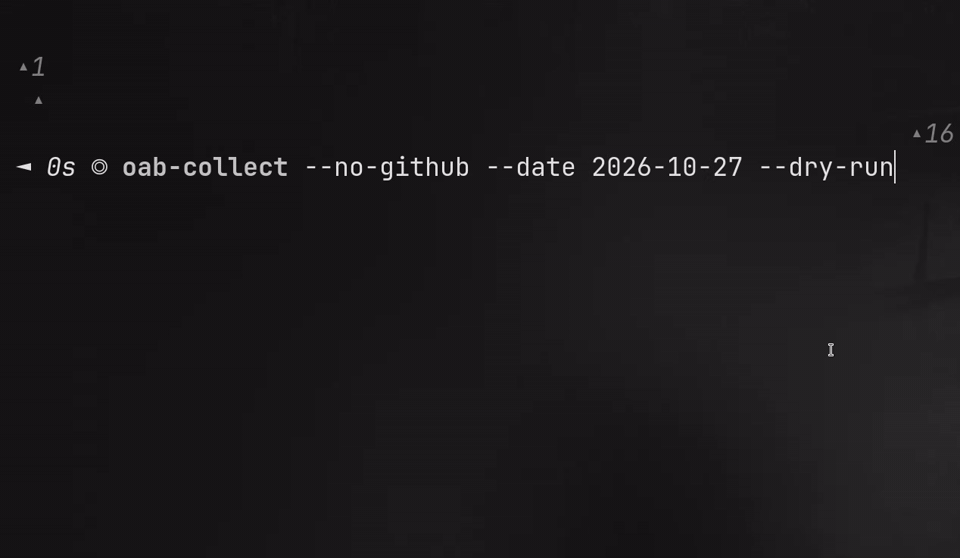
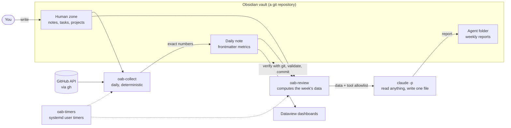
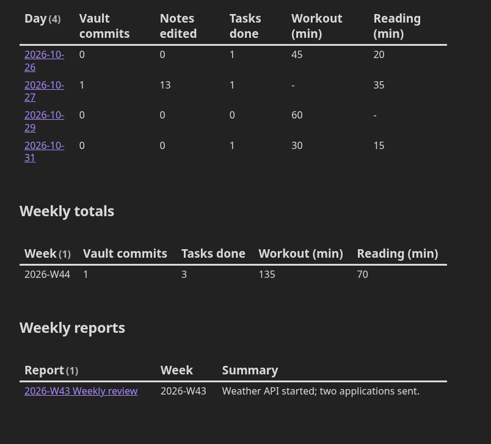

# obsidian-agent-backend

[](https://github.com/Restring17/obsidian-agent-backend/actions/workflows/ci.yml)
[](https://github.com/Restring17/obsidian-agent-backend/releases)
[](LICENSE)

Turn your [Obsidian](https://obsidian.md) vault into a **backend for AI agents**: a small database about your work and life that updates itself, and an AI agent that reviews it every week without being able to break anything.

## What it is

Many people want an AI assistant that knows their notes. But giving an agent write access to a vault you care about is risky: one bad run can rewrite or delete notes you wrote by hand. This project is a working pattern for doing it safely, in two layers:

1. **Facts, collected without AI.** Every day a script counts what happened: commits and pull requests on GitHub (optional), commits and edited notes in the vault, completed tasks, and the habits you log by hand, such as workout or reading minutes. The numbers go into the frontmatter of that day's note. Your vault becomes a plain-Markdown database you can query and chart with [Dataview](https://blacksmithgu.github.io/obsidian-dataview/).
2. **An agent with the smallest possible permissions.** Every week Claude reads those facts and your notes and writes one report: the week in three lines, what needs your attention, and whether last week's plan held. It can write that one file and nothing else. Afterwards git checks that nothing else changed.

You keep writing your notes as usual. The tools never change what you wrote: they only add the metric keys to the daily note's frontmatter and one log line per run.

**Who it is for:** people who already keep their work and life in Obsidian and are comfortable with a terminal, git and an AI command-line tool. That mostly means developers. It started as the setup of my own vault and was generalized, so anyone can adapt it with one TOML file.

## Features

- **Exact numbers, no LLM:** every day `oab-collect` writes GitHub and vault metrics into the frontmatter of your daily note, ready for [Dataview](https://blacksmithgu.github.io/obsidian-dataview/) dashboards.
- **A reviewer on a short leash:** every week `oab-review` runs `claude -p`. The agent can read the vault and write **one file**, its report. Afterwards git proves that nothing else changed before anything is committed.
- **Set and forget:** `oab-timers` schedules both commands with systemd user timers, which catch up after the PC was off.



## How it works



The vault is split into two zones (configurable in `oab.toml`):

- The **human zone** holds the folders you write. The tools read them but never edit them. The only exceptions are the metric keys in the daily note frontmatter and one log line per run.
- The **agent folder** holds what the agents write: reports and drafts.

## Quickstart

**You need** Python ≥ 3.12, [uv](https://docs.astral.sh/uv/) and git. You also need [`gh`](https://cli.github.com/) (logged in) for GitHub metrics, and [Claude Code](https://docs.anthropic.com/en/docs/claude-code) (`claude`) for the review. Tested on Linux; the timers need systemd.

**1. Install**

```sh
git clone https://github.com/Restring17/obsidian-agent-backend
cd obsidian-agent-backend
uv tool install .                 # puts oab-collect, oab-review and oab-timers on your PATH
```

**2. Try it on the example vault.** This fictional vault ([`examples/vault`](examples/vault)) covers ISO week 2026-W44. Work on a copy, because both commands commit:

```sh
cp -r examples/vault /tmp/oab-demo && cd /tmp/oab-demo
git init -q && git add . && git commit -qm "example vault"
oab-collect --no-github --date 2026-10-27 --dry-run
oab-review --week 2026-W44 --dry-run    # prints the prompt with the week's data; no model call
```

**3. Point it at your vault.** The vault must be a git repository, for example with the [Obsidian Git](https://github.com/Vinzent03/obsidian-git) plugin.

```sh
cp oab.example.toml ~/path/to/your-vault/oab.toml    # then edit it (see Configuration)
cd ~/path/to/your-vault
oab-collect --dry-run             # yesterday's metrics, written nowhere
oab-review --dry-run              # last week's prompt, no model call
```

**4. Go live.** Run `oab-collect` and `oab-review --test` once by hand. `--test` writes a `(test)` report without logging or committing. Then schedule both:

```sh
oab-timers install
systemctl --user list-timers 'oab-*'
```

## Configuration

[`oab.example.toml`](oab.example.toml) documents every key. Every key has a default, paths are relative to the vault and cannot leave it, and unknown keys are rejected. All commands read `./oab.toml` or `--config PATH`; the vault root is the folder that contains the file. An invalid file stops the command with exit code 2 and a one-line message.

| Section | What it sets |
|---|---|
| `timezone` | IANA timezone that decides where a day (and a week) starts |
| `[daily_notes]` | Folder of `YYYY-MM-DD.md` notes, optional template, heading of the AI log |
| `[human_zone]` | Your top-level folders (glob patterns), folders to skip, the `private` key |
| `[agent]` | The top-level folder the agents own |
| `[metrics]` | Keys you fill in by hand (for example `workout_min`), summed in the review |
| `[applications]` | Optional: a note with job applications as `[status:: applied]` fields |
| `[projects]` | Optional: a folder of project notes with a status field |
| `[review]` | Claude model and an optional custom prompt template |

## Daily collector

```sh
oab-collect                       # yesterday, in the configured timezone
oab-collect --date 2026-11-02 --days 7 --dry-run
oab-collect --no-github           # vault metrics only
```

It writes these keys to the frontmatter of `<daily_notes.folder>/YYYY-MM-DD.md`. It creates the note from the template only if the day had activity.

| Key | Source |
|---|---|
| `github_commits`, `github_repos`, `github_prs` | GitHub search API through `gh` (private repos included) |
| `vault_commits`, `vault_notes_edited` | `git log` of the vault |
| `tasks_completed` | `- [x] … ✅ YYYY-MM-DD` tasks in the human zone |
| `tasks_open`, `applications_active` | Current state; written only for today and yesterday |
| `collected_at` | Timestamp of the run |

Only those lines change: the body and every other key stay as they were, and the file is replaced atomically. If a source fails, its keys are left untouched (never written as zero) and the command exits with code 1.

## Weekly review

```sh
oab-review --dry-run              # print the prompt for last week, no model call
oab-review                        # last ISO week, in the configured timezone
oab-review --week 2026-W45 --model opus --force
oab-review --test                 # write a "(test)" report, no log or commit
```

The tool computes the week's data and passes it to the agent inside the prompt: metrics per day with totals, the AI log, vault commits, open tasks, applications and projects. The report goes to `<agent.folder>/Reports/<week> Weekly review.md`. A successful run logs one line in today's daily note and commits only what the tools wrote: the report, that line and the collector's keys in the daily notes. Your own edits stay uncommitted (see [Security model](#security-model)). It pushes only if the branch has an upstream. You can replace the [built-in prompt](src/obsidian_agent_backend/prompts/weekly_review.md) with your own (`review.prompt`).

## Security model

The agent is a language model reading notes you wrote, so any note could contain text that tries to steer it (prompt injection). The design assumes the agent may misbehave and limits what that can cost.

**Before the run: least privilege**

| Control | How |
|---|---|
| Tools | `--allowedTools Read Glob Grep Write(./<report>) Edit(./<report>)`: it can read, and write exactly one path |
| Denied tools | `--disallowedTools Bash WebFetch WebSearch NotebookEdit Task Agent`: no shell, no network, no sub-agents |
| Turns | `--max-turns 40`, and the whole run is killed after 15 minutes |
| No made-up numbers | Metrics and lists are computed by the tool, not by the model, and passed in the prompt |
| Private notes | Notes with `private: true` are left out of the precomputed data |
| No shell around it | Every command runs as an argument list (`subprocess` without a shell), with the executable resolved first |

**After the run: trust, but verify**

1. Before the agent starts, the tool takes the output of `git status --porcelain -z` and a SHA-256 hash of every file that is already modified. After the run it compares both. Any other new, changed or deleted file, **including edits to files you had left uncommitted**, fails the run. Nothing is logged or committed.
2. The report must exist and its frontmatter must have `type: agent`, the right `week` and a non-empty `summary`.
3. The commit holds only what the tools wrote, even in a note you are editing. Each changed daily note is rebuilt from its committed version (or the template, if git does not track it yet) plus the collector's keys and the review's log line. The commit is built in a temporary index, so your working tree and your staged changes are never used. It moves the branch only if nobody committed in the meantime.
4. Afterwards your edits are still there, unstaged; anything you had staged is still staged, with the tool's edits added so your next commit does not undo them. A note whose edits cannot be told apart (for example a committed version without frontmatter) is left uncommitted and named in the output.

**Limits, stated plainly**

- **Reading is not sandboxed.** `Read`, `Glob` and `Grep` are allowed without a path pattern, so the agent can read any file the tools can reach, including notes marked `private: true`. Keep secrets out of the vault, and do not run it as a user whose files you would not show the model.
- **The commit bypasses git hooks.** It is made with `git commit-tree`, so `pre-commit` and `commit-msg` hooks do not run and `commit.gpgSign` is not applied.
- **A failed check is not a rollback.** It means nothing was committed. The changed files stay in your working tree, listed in the error message, for you to inspect and `git restore`.
- Its guardrails are those of Claude Code's permission flags. Keep `claude` up to date.

## Scheduling

`oab-timers` runs both commands with **systemd user timers** (Linux). It needs no cron and no root.

```sh
oab-timers print                  # show the four unit files, change nothing
oab-timers install                # write them to ~/.config/systemd/user and enable them
systemctl --user list-timers 'oab-*'
oab-timers uninstall              # disable both timers and remove the files
```

- `oab-collect.timer` runs every day at 09:00 and collects yesterday plus the two previous days.
- `oab-review.timer` runs every Monday at 09:30. It first refreshes the metrics of the past 8 days; if that fails, the review still runs.
- Both timers have `Persistent=true`: when the PC was off at that time, the run happens at the next boot.
- Times are in the **vault timezone** from `oab.toml`, not the system one. Change them with `--collect-at` and `--review-at`. Both take [systemd calendar expressions](https://www.freedesktop.org/software/systemd/man/latest/systemd.time.html#Calendar%20Events) such as `"Mon..Fri *-*-* 07:30"`.
- `--no-github` makes the daily collector skip GitHub.
- The services get a minimal `PATH`: the folders of `oab-*`, `git`, `gh` and `claude` found at install time, plus the system folders. Re-run `oab-timers install` if you move them.
- The units are checked with `systemd-analyze --user verify` before anything is written. `install` and `uninstall` only replace or remove files they generated, which carry a header comment. Use `--force` to replace your own.
- Logs: `journalctl --user -u oab-collect -u oab-review`.

To pause without uninstalling, run `systemctl --user disable --now oab-collect.timer oab-review.timer`. The units are templates in [`src/obsidian_agent_backend/systemd/`](src/obsidian_agent_backend/systemd), so you can also install them by hand.

## Dashboards with Dataview

The collected keys are plain frontmatter, so any [Dataview](https://blacksmithgu.github.io/obsidian-dataview/) query can use them. These snippets assume the folders of the example config (`Daily`, `Agents`) and its manual metric `workout_min`; adjust the names to yours.

The example vault ships a ready-made [`Dashboard.md`](examples/vault/Dashboard.md), pinned to its week 2026-W44:



**Last 14 days**

````markdown
```dataview
TABLE WITHOUT ID file.link AS "Day", github_commits AS "GitHub commits", github_prs AS "PRs",
  vault_commits AS "Vault commits", tasks_completed AS "Tasks done", workout_min AS "Workout (min)"
FROM "Daily"
WHERE file.day AND file.day >= date(today) - dur(14 days)
SORT file.day DESC
```
````

**Totals per ISO week**

````markdown
```dataview
TABLE WITHOUT ID Week, sum(nonnull(rows.github_commits)) AS "GitHub commits",
  sum(nonnull(rows.tasks_completed)) AS "Tasks done", sum(nonnull(rows.workout_min)) AS "Workout (min)"
FROM "Daily"
WHERE file.day AND file.day >= date(today) - dur(8 weeks)
GROUP BY dateformat(file.day, "kkkk-'W'WW") AS Week
SORT Week DESC
```
````

**Weekly reports**

````markdown
```dataview
TABLE WITHOUT ID file.link AS "Report", week AS "Week", summary AS "Summary"
FROM "Agents/Reports"
WHERE type = "agent"
SORT week DESC
```
````

**Daily notes the collector never wrote to** (it did not run that day, or every source failed)

````markdown
```dataview
LIST
FROM "Daily"
WHERE file.day AND file.day >= date(today) - dur(30 days) AND !collected_at
SORT file.day DESC
```
````

## Quality bar

- ≥ 90 % branch coverage, enforced in CI (the suite is at 100 %), on Python 3.12 and 3.14.
- End-to-end tests run both commands against a copy of the example vault with real git, fake `gh` and fake `claude`.
- Mutation testing (`mutmut`) every Monday, non-blocking: score ≈ 97 %. Every surviving mutant is reviewed in [docs/mutation-testing.md](docs/mutation-testing.md).
- Static analysis with `ruff`, `mypy --strict` and `bandit`; secret scanning with `gitleaks`.
- Dependabot opens weekly PRs into `develop` for Python packages and GitHub Actions. Actions are pinned by commit SHA.

## Development

```sh
uv sync                    # create .venv with the dev tools
uv run pytest              # tests + branch coverage (fails under 90 %)
uv run pytest -m e2e       # end-to-end only: examples/vault, real git, fake gh and claude
uv run ruff check          # lint
uv run mypy                # strict type checking
uv run bandit -c pyproject.toml -r src
uv run mutmut run          # mutation testing (about a minute); see docs/mutation-testing.md
```

The workflow (Scrumban sprints, GitFlow branches and Conventional Commits) is described in [CONTRIBUTING.md](CONTRIBUTING.md). Planned work lives on the [project board](https://github.com/users/Restring17/projects/2).

## License

[MIT](LICENSE) © 2026 Adrian Ramírez
